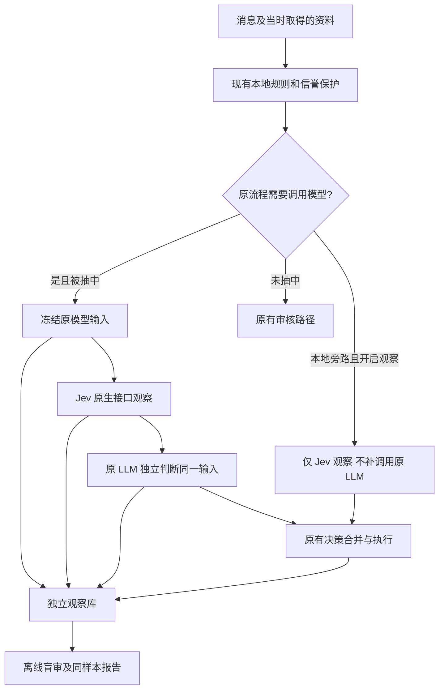

# Jev 实时观察

本地实现与模拟测试已完成。代码默认关闭，生产启用须由环境配置显式指定。
此阶段的“第一顺位”表示 Jev 先取得冻结输入并完成观察；真实处罚、投票、信誉和指纹反馈仍由现有规则与原 LLM 决定。
代码只接受 `off` 或 `shadow`，没有直接执行 Jev 结论的模式。

## 实际处理过程



群白名单和固定哈希抽样限定观察范围。输入在所有模型 await 之前深拷贝冻结；原模型不接收 Jev 的答案。
日常指纹质量扫描继续使用原 judge，不走 Jev。
白名单用户、管理员等现有提前返回路径不被额外采集；默认本地硬规则旁路也不调用 Jev。
`JEV_OBSERVE_LOCAL_BYPASS=true` 只能覆盖继续到决策执行阶段的旁路，不能代表全群流量普查。

## 两个模型实际收到什么

复用 `llm._feature_payload()`，没有为 Jev 偷加历史处置标签：

| 字段 | 当前边界与含义 |
| --- | --- |
| `raw_text` / `clean_text` | 各前 4,000 字符；原始串保留零宽字符，不再次规范化 |
| `skeleton` 与哈希 | 骨架前 1,000 字符、内容/骨架哈希；不含最终指纹反馈 |
| `sender_reputation` / `user_trust` | 判断开始时现有流程已取得的信誉与信任状态 |
| 链接 | 来源、域名、每个 URL 前 500 字符；mention 数、空文本、预览标志 |
| `sender_profile` | 现有流程拿到的昵称、用户名、Bio 等；Bio 可能来自现有缓存，不宣称是消息发送瞬间的真实资料 |
| `personal_chat` | 现有流程按触发条件取得的频道标题/用户名及最多 3 条、每条 1,200 字符内容；未取得就缺失 |
| `og_preview` | 原有 OG 抓取结果；没有就缺失，不额外补抓 |
| `edited_from` | 原有编辑前快照，正文最多 4,000 字符，未取得就缺失 |

保存输入哈希、Questions 哈希、原 System Prompt 哈希、策略版本、请求及返回模型版本、原模型实际成功 provider。
同时保存原文长度和是否因 4,000 字符边界被截断。大于 64 KiB 的整体输入跳过观察并走原模型路径。
该库保存的是“本次模型实际可见的上下文”，不能用于声称恢复以前所有消息的历史状态。
不添加原模型结论、未来信誉、管理员票数、最终处置或根据答案编写的解释 Context。

## Jev 协议和固定 Questions

使用官方原生 `POST https://api.typesafe.ai/v1/systemone`，Bearer 认证，UTF-8 JSON
`{model, state, questions}`，没有使用 OpenAI Chat Completions 模拟。
默认固定 `jev-1.13.0`；配置要求精确版本，禁止 `jev-latest` 漂移。

Questions 对所有样本一致。以现有中文 `_SYSTEM_PROMPT` 的语义规则为基础，去掉原 JSON 输出格式要求，
补充不可信输入及“账号资料有广告不等于本条消息有广告”的边界。保留隐晦推广、混淆字符、
OG、个人频道、空正文/Bio 和普通讨论等现有政策。

- `is_spam`：Noul，判断当前消息主动广告或商业引流，主判断取 Noul ≥0.5。
- `category`：Choice，`ads/scam/porn/gambling/crypto/traffic_diversion/mass_mention/benign/unknown`。

分别保存原始响应、Noul、Choice 完整概率分布和 Choice confidence；不把三者当作相同的概率。
Choice 为广告类但 Noul <0.5 时保留分歧标记，不擅自改写 Noul。
检查数值有限性、范围、模型版本、选项完整性和概率和；错误响应不参与准确性比较。

官方资料：[接口](https://docs.typesafe.ai/api.md)、[置信度](https://docs.typesafe.ai/confidence.md)、[模型版本](https://docs.typesafe.ai/models.md)。
2026-10-19 从生产服务器使用合成正常技术文本完成真实接口预检：固定模型返回正常结果，
耗时约 484 ms，输入 2,451 / 输出 110 Token；该样本不进入真实消息准确性统计。

## 开关与失败处理

`.env.example` 已给出所有默认值；生产配置与密钥仅写服务器受限权限 `.env`。

| 配置 | 默认 | 行为 |
| --- | --- | --- |
| `JEV_MODE` | `off` | 不建观察库、不调用 Jev；单有 Key 不会启用 |
| `JEV_API_KEY` | 空 | 仅从环境读取，兼容 `TYPESAFE_API_KEY`；不写入代码、结果或日志 |
| `JEV_CHAT_IDS` | 空 | shadow 必须明确列出群 ID |
| `JEV_SAMPLE_RATE` | `0.1` | 按群/消息/正文哈希/更新类型确定性抽样 |
| `JEV_TIMEOUT_SECONDS` | `3` | 独立硬超时，允许范围 (0,10] 秒 |
| `JEV_MAX_CONCURRENT` | `2` | 满额直接跳过，不排队阻塞原审核 |
| `JEV_MAX_CALLS_PER_DAY` | `200` | UTC 日原子计数；失败请求也占额度 |
| `JEV_MODEL` | `jev-1.13.0` | 固定版本 |
| `JEV_RETENTION_DAYS` | `7` | 可设 1–30 天 |
| `JEV_OBSERVE_LOCAL_BYPASS` | `false` | 旁路单列，原模型标记 not_called |
| `JEV_OBSERVATION_PATH` | `data/jev-observations.db` | 必须与审核主库分离 |
| `JEV_PROXY_URL` | 空 | 如需代理显式填写；HTTPX `trust_env=False`，不恢复全局代理 |

请求顺序是 Jev → 原 LLM，因此被抽中的消息会多等待 Jev 耗时，上界为设置的超时及本地存储开销。
不启用自动重试；401/403 停止后续 Jev 调用直至重启；429/503/529 进入 1–60 秒冷却。
Jev 超时、解析失败、冷却、预算耗尽和旁路写库失败都不产生处罚或学习。
观察库不可用时原审核继续；启动时非法显式配置则报错，避免误以为观察已启用。
缓存按完整 state + Questions hash + Jev model 区分，修改 Bio/OG/信誉等也会使缓存失效。
缓存命中不计实际 API 请求、耗时分位数和 Token 消耗。

观察库只有短期明文输入和独立标注；每小时最早一次被选中的消息触发过期清理，
报告始终排除逻辑已过期记录。Bot 停止时不会后台物理清理；SQLite 删除也不是安全擦除。
导出文件由操作者自行保管/删除，不随数据库到期自动删除。
默认所有运行时数据位于 Git 忽略的 `data/`，不要把自选导出路径提交到仓库。

## 报告和人工标注

以下是观察数据的使用方法。模块方式无需重装命令行入口：

```powershell
.venv/Scripts/python.exe -m telegram_llm_antispam.jev_live_report report --db data/jev-observations.db --out-dir data/jev-live-export --sample-size 50 --seed 20261019
```

输出 `dataset.jsonl`、`annotations.jsonl`、`blind_review.jsonl`、`comparison.csv`、`metrics.json`、`report.md` 和 `events.json`。
如显式增加 `--moderation-db data/bot.db`，仅用 SQLite `mode=ro` / `query_only` 查询该消息对应投票会话的事件。
报告不初始化、迁移或写入审核主库，也不调用任何模型。
日后安装本项目后可用等价入口 `antispam-jev-live`。

盲审队列按随机种子从所有保留观察中抽取，包括模型认为正常的消息，避免只核查可疑消息。
它隐藏两个模型的答案、最终处置及投票结果；保留模型实际输入及正文截断标记。
两位标注者应分别审核独立副本，不预先相互展示答案。
填写 `reviewer_id`、`task`、`label`（spam/ham/unknown）、`evidence_sufficient` 和简短 `note`，保留 observation ID 和 payload hash。
`task=message` 是本条消息；`profile/account/behavior` 分别记录资料、账号或行为证据，不向消息标签传播。
入群检查队列默认 `profile`；只看到正常聊天加可疑 Bio 时，应将消息与资料分开标注，证据不足选 unknown。

```powershell
.venv/Scripts/python.exe -m telegram_llm_antispam.jev_live_report labels --db data/jev-observations.db --file data/reviewer-a.jsonl
.venv/Scripts/python.exe -m telegram_llm_antispam.jev_live_report labels --db data/jev-observations.db --file data/reviewer-b.jsonl
```

导入只写独立观察库；整批校验后事务提交。未知/已过期 ID、不同输入哈希、空标注人或非法标签均拒绝。
同一标注者/任务可修订，不能重复凑票；冲突、不充分和 unknown 不自动形成真值。

## 指标口径和上线前仍需知道的限制

成对指标只使用同一 observation ID、同一输入哈希、两个模型均成功且至少两名标注者一致确认的消息。
入群资料检查、正文截断、空/标点正文且无 OG 等不能支撑消息级任务的记录排除于消息分母，仍保留供资料/账号复核。
有 OG 的空正文不一刀切删除，需标注者确认其证据充分。
按 Questions、原提示词、Jev 版本、原模型实际成功 provider/model 分组；混合组时取消汇总准确性指标。
原模型失败、禁用、缺失、未调用和 Jev 跳过/失败分别记录，不算模型误判。

报告包含召回、精确率、F1、漏判率、误杀率、Noul 与 Choice confidence 的独立分布、
实际请求失败率、成功请求延迟 P50/P95、输入/输出 Token 总数和均值。
`--input-usd-per-million` 可按合同价格估算输入费用；未给价格就不猜成本，输出/其他费用需另算。
模型一致率仅衡量意见相同，不能叫正确率。
管理员封禁、confirmed_spam、兄弟投票会话被连带关闭、自动放行均不自动产生单条消息真值。
新事件会记录 `primary_vote_session_id`，以识别实际被点击会话；历史缺失值不推测补齐。

用户级准确率暂为缺失：本实现的主要 Questions 是消息识别，没有独立账号分类器或足够账号真值。
资料/账号标注可以保留，不能把 Noul 的消息答案直接冒充账号答案。
默认采集点受本地规则筛选，覆盖面需从旁路统计判断；不能把指纹命中归功于 Jev。
现有离线审计中的 7 条人工正常样本、4 条独立正文和 71 条待标注候选仍不足以估计实际误杀率。
需继续从真实普通流量中盲抽正常及困难场景，完成独立人审后再报告正确率。
当前没有根据观察结果修改 70%/85% 阈值、生产规则或执行权，也不把未经校准的 Jev 概率视为安全处罚阈值。

2026-10-19 用户授权部署观察模式；初始范围为当时已允许的两个群，抽样 10%，UTC 日上限 200，
超时 3 秒、并发 2、保留 7 天。本地硬规则旁路不额外观察，原 LLM 保留全部执行权。
批量历史重跑仍暂停。任何直接采用 Jev 结论的执法模式需单独实现与决定。

## 本地验证

本轮完整回归 `270 passed`，新增 Jev 测试 40 项，相关生产文件与新文件的 Ruff 检查、
`git diff --check` 通过。测试使用临时数据库、模拟 HTTP 与 Telegram；覆盖同一冻结输入、
相反模型答案下原处罚/信誉/指纹路径不变、超时、认证禁用、冷却、并发、取消、预算、缓存失效、
保留期、两人标注、版本分组以及管理员主会话与连带关闭的区分。
